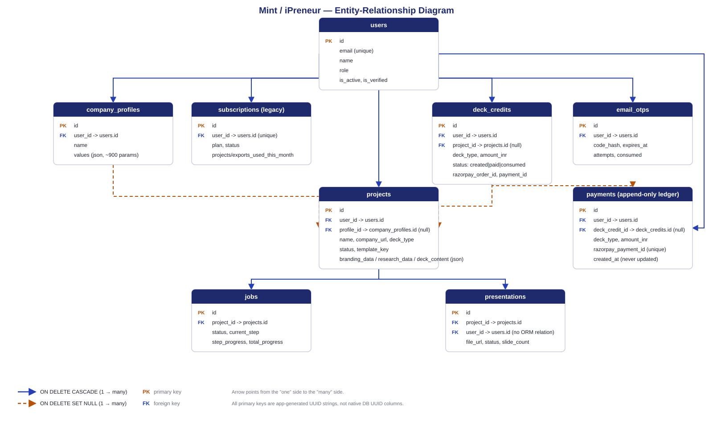

# iPreneur ("Mint") — System Architecture

This describes the system as the code implements it today. For the full fact-by-fact backing (file:line references), see the research that produced this doc: [api-reference.md](../api-reference.md), [data-model.md](../data-model.md), [ai-pipeline.md](../ai-pipeline.md), [frontend.md](../frontend.md), [deployment.md](../deployment.md).

## 1. System overview

```
┌──────────────────────────────────────────────────────────────────────┐
│ CLIENT — React SPA (Vite + TS, hosted on Firebase Hosting)           │
│  Landing · Auth (email+OTP, Google OAuth) · Dashboard · New-Project  │
│  Workspace (poll progress) · Editor (slide editor) · Templates       │
│  Billing · Settings                                                   │
└───────────────────────────────┬────────────────────────────────────────┘
                                 │ REST (axios, JWT bearer)
┌───────────────────────────────▼────────────────────────────────────────┐
│ API — FastAPI (Python 3.11), single Cloud Run service, one process    │
│  /api/v1/auth  /users  /projects  /deck-types  /profiles  /decks      │
│  /presentations  /billing  /webhooks  /pipeline                       │
└───────┬───────────────────────────────────────────────┬────────────────┘
        │                                               │
┌───────▼────────────┐                        ┌─────────▼─────────┐
│ Supabase Postgres    │                        │ Supabase Storage    │
│ users, projects,      │                        │ (S3-compatible)     │
│ presentations, jobs,  │                        │ decks/{project}/... │
│ subscriptions (legacy)│                        │ + local fallback    │
│ company_profiles,     │                        │   under backend/    │
│ deck_credits,          │                       │   storage/ in dev   │
│ email_otps             │                       └────────────────────┘
└───────────────────────┘
```

**There is no separate worker tier in production.** Generation runs as a detached background thread *inside the same FastAPI process* that served the request (`app/api/v1/endpoints/projects.py`), not in Celery. Celery, Redis, and a `beat` schedule exist in the repo (`app/workers/`, `docker-compose.yml`) but are not invoked anywhere the live product uses — see [ai-pipeline.md](../ai-pipeline.md) §"Two pipelines" for why this matters (a server restart during generation strands the job).

## 2. Request flow — generating a deck

```
1. POST /api/v1/projects {name, company_url?, deck_type, start_analysis:true}
     │  (JWT required; validates deck_type and its required brief fields;
     │   if deck_type is priced, requires an already-paid DeckCredit — 402 otherwise)
     ▼
2. API creates Project(status="draft"→queued work) + Job(status="queued"),
   responds immediately, then spawns a daemon thread with its own asyncio
   event loop running `_run_analysis_inline()`.
     │
     ▼
3. Background thread, step by step (Job.current_step / step_progress reported
   for the frontend's 3s poll of GET /projects/{id}/status):
     "crawling"   0→25%   WebCrawler (Playwright BFS) — skipped if no company_url
     "generating" 25→75%  MasterDeckAgent (Gemini, two-pass: research + generate)
     "rendering"  75→95%  PPTRenderer (python-pptx)
     "uploading"  95→100% StorageClient → Supabase Storage / local fallback
     │
     ▼
4. Project.deck_content, research_data, branding_data persisted;
   Presentation row created; Job.status = "completed" (or "error" with
   Job.error set, and Project.status = "error").
```

The frontend polls `GET /projects/{id}/status` every 3 seconds while status is `analyzing`/`researching`/`generating`, rendering `JOB_STEP_ORDER` from `frontend/src/constants/index.ts` against `Job.current_step`.

## 3. The AI pipeline, in brief

Full detail in [ai-pipeline.md](../ai-pipeline.md). Summary:

- **Provider**: Google Gemini only, via a hand-written `httpx` client (`app/core/genai_client.py`) — not the official SDK, not Claude/Anthropic, anywhere.
- **Two API keys**: `GEMINI_API_KEY` for content generation, `GEMINI_API_KEY_2` for the research pass — kept separate to avoid rate-limiting one call with the other.
- **One agent, two passes**: `MasterDeckAgent` runs a research pass (Gemini + Google Search grounding) then a generation pass (one large prompt producing the full slide set as structured JSON) — not four separate agents in sequence.
- **Deck types drive everything**: 14 deck types (`app/decks/registry.py`), each an ordered list of "sections." The frontend's New-Project form, the AI prompt's slide plan, and the PPTX renderer's layout dispatch are all derived from the same registry, not duplicated per surface.
- **Rendering**: `python-pptx`, 32 color/typography themes, 6 layout archetypes (full-bleed, big-number, cards, two-column, timeline, title-bullets), with real editable native charts/tables for KPI, market-sizing, use-of-funds, and competitor-comparison sections — not images of charts.
- **A legacy 4-agent/Celery pipeline still exists in the repo** (`app/workers/`, `app/agents/{research,content,analysis}/`) but is not called by anything in the live request path. It's reachable only through the standalone, **unauthenticated** `POST /api/v1/pipeline/generate` preview endpoint, which does not create a Project or persist anything — see [security.md](../security.md).

## 4. Data model (summary)

Full detail in [data-model.md](../data-model.md), including every column and constraint. Entity-relationship diagram:



Key relationships, in short:

```
User ──1:N── Project ──1:N── Job
 │  │                └──1:N── Presentation
 │  └──1:N (legacy, effectively 1:1 via unique FK)── Subscription
 ├──1:N── CompanyProfile ──1:N(nullable)── Project.profile_id
 ├──1:N── DeckCredit ── nullable FK → Project
 ├──1:N── Payment  (append-only ledger — see below)
 └──1:N── EmailOtp
```

**`Payment`** is an append-only ledger, separate from `DeckCredit`'s mutable `created→paid→consumed` state machine: a row is written once, at the moment a payment is confirmed, and never changes afterward — so "has this person paid" is never ambiguous the way reading `DeckCredit.status` alone can be once a credit is consumed. See [billing.md](../billing.md).

**`CompanyProfile.values`** is a sparse, ~900-parameter catalogue (founder facts, metrics, team, market data) that multiple decks for the same company can draw from, each pulling only the parameters its deck type actually uses. See [company-profiles.md](../company-profiles.md).

Notable implementation details:
- Primary keys are app-generated UUID **strings**, not DB-native UUID columns.
- JSON columns (`branding_data`, `research_data`, `deck_content`, `CompanyProfile.values`) are stored as `TEXT` on both Postgres and SQLite via a custom `TypeDecorator` — despite a code comment claiming native JSONB on Postgres, they are not.
- **No Alembic.** Schema is created by `Base.metadata.create_all()` at startup (new tables only) plus a hand-maintained, idempotent `scripts/db/init.sql` for column additions to existing tables, applied via `scripts/db/migrate.py`. A drift check (`check_schema_drift()`) runs on every startup and logs any mismatch.

## 5. Frontend (summary)

Full detail in [frontend.md](../frontend.md). React 18 + TypeScript + Vite SPA, React Router, React Query for all server data (no Redux-style global data store), a single Zustand store for auth only. The most substantial subsystem is the deck-template rendering engine (`frontend/src/components/workspace/deckTemplates/`): 41 visual themes across 4 families, a registry mirroring the backend's deck-type registry, and a pixel-exact PPTX exporter that rasterizes the same React-rendered slide the user previewed (via `html-to-image` + `pptxgenjs`) so what the user sees is exactly what they download.

The frontend currently runs **two parallel design-token systems** (an older dark Tailwind palette and a newer light CSS-variable system called "Kiln") that aren't reconciled — see [frontend.md](../frontend.md) §8.

## 6. Security model

- **Auth**: stateless JWT (HS256), 6-day expiry, no refresh token, no revocation/blacklist — logout is cosmetic.
- Every `/projects`, `/decks`, `/presentations`, `/profiles`, `/billing/credits` route scopes to `current_user` server-side; soft deletes on projects.
- Razorpay payment verified two independent ways: client-callback HMAC check and a server-to-server webhook (defense against a closed browser tab).
- Production boot refuses to start with placeholder secrets, a short JWT key, debug mode on, or `localhost` left in CORS origins.
- **Open items** (see [security.md](../security.md) for detail and recommended action): a committed file with real plaintext credentials, and an unauthenticated endpoint that triggers real (billable) Gemini calls.

## 7. Deployment (summary)

Full detail in [deployment.md](../deployment.md). The live stack:

```
Backend:  Google Cloud Run, service "pitch-deck-backend", region asia-northeast1,
          auto-deployed by a Cloud Build trigger on push to main.
Frontend: Firebase Hosting, project "pitch-deck-e1d6c", domain pitchdeck.infopaceindia.com,
          auto-deployed by GitHub Actions (Workload Identity Federation, no stored key).
Database: Supabase-hosted Postgres (ap-northeast-1), via asyncpg + PgBouncer pooling.
Storage:  Supabase Storage, S3-compatible endpoint, bucket "decks".
```

`render.yaml`, `docker-compose.yml` (Celery worker/beat), `wrangler.jsonc` (Cloudflare), and `vercel.json` describe alternate or abandoned deployment attempts and do not reflect what's currently serving traffic — see [deployment.md](../deployment.md) for the full comparison table.

## 8. Unused scaffolding

Two directories exist but are confirmed dead, for completeness:

- **`ipreneur/shared/`** (`constants/index.ts`, `types/index.ts`) — an early attempt at a frontend/backend shared-types package. Nothing in `frontend/src/` or `backend/app/` imports from this path; the frontend's own `src/constants/` and `src/types/` are what's actually used.
- **`backend/app/hooks/`** — contains only an empty `__init__.py`. No webhook/event-hook logic lives here; see [billing.md](../billing.md) for the real payment webhook, which lives under `app/api/v1/endpoints/webhooks.py`.

Neither affects runtime behavior; both are safe to delete whenever someone is cleaning up the repo, and are noted here only so they aren't mistaken for load-bearing code.
