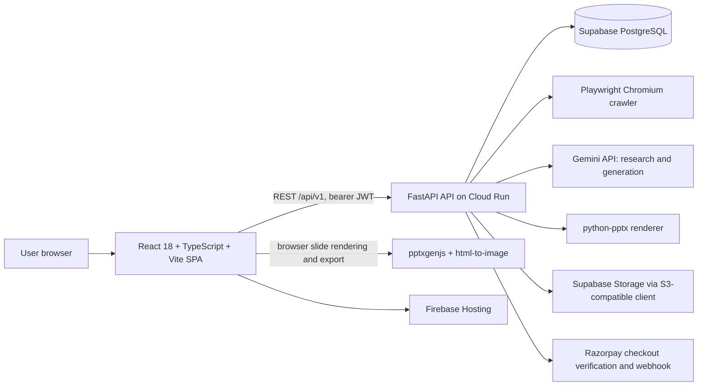

# Mint (iPreneur): Product and Architecture Report

**Audience:** product, design, engineering, support, and operations  
**Purpose:** explain what the product does, how its main user journeys work, and how the current implementation is assembled.  
**Scope:** repository behavior inspected on 17 November 2026. This describes implementation, not a promise about future functionality or a formal service-level commitment.

## 1. Product summary

Mint is a pitch-deck studio for founders and business teams. It turns company information into audience-specific presentation content, lets the user review and edit that content in a browser workspace, and exports a PowerPoint file. Company information can come from a supplied website, founder-entered intake answers, and an optional reusable company profile. The product offers multiple deck types for different jobs, including fundraising, sales, product, business, partnership, internal, and update presentations.

The product’s value proposition is reducing the time and expertise needed to make a coherent first draft. Generated content is an AI-assisted draft; users remain responsible for checking facts, projections, claims, and suitability before sharing it.

## 2. Users and jobs to be done

| User | Need | Product response |
|---|---|---|
| Founder preparing to raise | Explain the opportunity and earn an investor follow-up | Investor deck type, website research, founder inputs, narrative, financial and ask sections |
| Founder or operator selling a product | Explain customer pain, fit, proof, and next step | Sales deck type and audience-specific section plan |
| Team communicating internally or externally | Reuse company facts in a different presentation context | Reusable company profile plus deck-type-specific selection of relevant facts |
| Returning user | Revise and export an existing presentation | Dashboard, workspace, editor, themes, and on-demand PPTX rendering |

## 3. Product surface and capabilities

### Account and workspace

- Email/password registration with email OTP verification, login, and Google sign-in.
- Authenticated dashboard and project list.
- Project creation with company URL, selected deck type, intake answers, optional profile, and optional branding assets.
- Per-user project access; project deletion is soft deletion.

### Deck creation and editing

- Deck types are served from the backend registry. The frontend fetches the catalog and builds the intake form from each type’s required and optional fields.
- Website crawling is optional. If a URL is supplied, the crawler collects site text, images, colors, pricing, and team signals within configured limits.
- A two-pass Gemini-backed master agent researches and drafts structured slide content.
- The workspace displays generation progress and a preview; users can edit slide data and choose a theme.
- The browser template engine exports a PPTX by rasterizing its rendered slides and layering clickable link regions. The backend also has a `python-pptx` renderer used in generation/storage flows. These are distinct rendering paths and should be considered when diagnosing visual differences.
- A saved profile can hold reusable company parameters and be selectively rendered into a deck prompt. Profile readiness endpoints expose missing fields for a deck type.

### Billing

- One-time Razorpay purchases create credits for a specific deck type; there is no active subscription checkout flow.
- A paid credit is consumed when generation starts and associated with the resulting project. The documented payment ledger is `payments`; `deck_credits` tracks credit lifecycle.
- Pricing is defined in backend code and exposed through the public pricing API. See [billing](billing.md) for prices and flow details.

## 4. Core user journeys

### First deck

1. A visitor chooses a deck type and enters the project workflow.
2. The user signs in or registers and verifies email (unless using Google sign-in).
3. The app requests the deck type catalog and renders the appropriate intake fields.
4. The user adds company details, a URL if available, and optionally selects a saved profile or uploads a logo/gallery images.
5. For a paid deck type, the app opens Razorpay checkout when no eligible paid credit exists. Verified payment creates a deck credit.
6. The API creates a project and job, consumes an eligible credit where required, and immediately returns the project response.
7. The browser polls job status. The API thread crawls (if applicable), generates content, renders a PPTX, stores it, and records the completed presentation.
8. The user reviews the workspace, edits content/theme, and downloads the deck.

### Repeat deck from a profile

1. The user creates or updates a company profile, a sparse parameter set with provenance/confidence metadata.
2. The user starts a new project and selects that profile and a deck type.
3. The API renders only the parameters relevant to that deck and stage into the generation context; the deck type determines its section plan.
4. The same generation and review journey applies.

### Regenerate or export

The analyze action reruns generation for an existing project subject to the same payment/credit rules. Download can re-render stored deck content with the currently selected template; it does not necessarily make another AI call. The `format` query parameter currently does not select another output format: the endpoint returns PPTX.

## 5. System architecture



### Runtime components

| Component | Responsibility | Main code/config |
|---|---|---|
| Frontend SPA | Routing, auth UI, project intake, status polling, profile/billing screens, deck preview/editor/export | `frontend/src/`, `frontend/package.json` |
| FastAPI application | REST API, auth and ownership checks, project/job orchestration, startup checks | `backend/app/main.py`, `backend/app/api/v1/` |
| SQLAlchemy persistence | Users, profiles, projects, jobs, presentations, credits, payments, OTPs | `backend/app/models/models.py`, `backend/app/db/` |
| Generation thread | Current live generation runner; executes inside the API container/process | `backend/app/api/v1/endpoints/projects.py` |
| Crawler | Bounded Playwright site crawl and signal extraction | `backend/app/services/crawler/web_crawler.py` |
| Master agent | Gemini research and structured deck content generation | `backend/app/agents/master/master_agent.py`, `backend/app/core/genai_client.py` |
| PPTX renderers | Backend `python-pptx`; client template renderer/export | `backend/app/ppt/engine/`, `frontend/src/components/workspace/deckTemplates/` |
| Object storage | Deck outputs in Supabase Storage/S3-compatible service; local fallback | `backend/app/services/storage/` |
| External providers | Gemini, Razorpay, SMTP, Google identity, optional Sentry | `backend/app/core/config.py` |

### Production topology

The deployment docs identify Firebase Hosting for the SPA, Google Cloud Run for the API, and Supabase for PostgreSQL and storage. Production generation currently uses a detached daemon thread inside the API process; there is no deployed Celery worker tier documented by the active setup. This makes long-running work vulnerable to process replacement. Startup reconciliation converts orphaned running/queued jobs into visible errors, but does not resume the work. See [deployment](deployment.md) and [AI pipeline](ai-pipeline.md).

## 6. Generation lifecycle and data flow

```mermaid
sequenceDiagram
  participant B as Browser
  participant A as FastAPI
  participant D as PostgreSQL
  participant W as Generation thread
  participant C as Crawler
  participant G as Gemini
  participant S as Storage
  B->>A: POST /projects (JWT, intake, deck_type)
  A->>D: Validate ownership/rules; create Project + Job; consume credit if needed
  A-->>B: Project response
  A->>W: Start daemon thread
  B->>A: GET /projects/{id}/status (poll)
  W->>C: Crawl URL if supplied
  W->>G: Research pass and structured generation pass
  W->>D: Persist research, branding, deck content and status
  W->>S: Upload rendered PPTX
  W->>D: Create Presentation; mark job/project complete
  B->>A: GET /presentations/{id}/download or project export route
  A-->>B: PPTX file
```

Current live progress step names are `crawling`, `generating`, `rendering`, and `uploading`. Website crawling is skipped when no URL is supplied. Generation and storage errors are attached to job/project state. A process restart can interrupt a run; the startup reconciliation makes the interruption visible for retry.

### Registry-driven deck composition

The backend deck registry (`backend/app/decks/registry.py`) owns deck type metadata, audience, required intake, research level, sections, stage variations, and dynamic appendix behavior. The API exposes this catalog to the frontend. Prompt construction and backend renderer dispatch also use section data. The frontend contains a mirrored section/theme registry for rendering; a synchronization test is intended to catch drift. Changing a deck type therefore requires coordinated checks across backend catalog, schemas/prompts/rendering, frontend rendering, and tests.

## 7. Data model and ownership

The primary relationship is `User → Project → Job/Presentation`; a user can also own reusable `CompanyProfile`, `DeckCredit`, `Payment`, and `EmailOtp` records. A project may reference a profile. A credit may reference the project on which it was spent. The detailed [data model](data-model.md) documents columns, constraints, and schema application.

Key data concepts:

- **Project:** intake, selected deck type, lifecycle status, generated JSON content, and asset metadata.
- **Job:** asynchronous generation status, current step, progress, timestamps, and error details.
- **CompanyProfile:** reusable sparse company parameter values with metadata about source and confidence.
- **Presentation:** generated file metadata and status.
- **DeckCredit:** payment-backed right to generate one deck of one type; `created → paid → consumed`.
- **Payment:** payment confirmation ledger, separate from credit lifecycle.
- **EmailOtp:** bcrypt-hashed, short-lived, attempt-limited verification code.

Data ownership is enforced in API query paths for user resources. JSON-like model fields are serialized through a custom SQLAlchemy type; schema evolution is currently a combination of `create_all`, hand-maintained SQL, and drift checks rather than a versioned Alembic migration history.

## 8. API surface

Base path: `/api/v1`. The primary resource groups are:

| Group | Purpose | Access |
|---|---|---|
| `/auth`, `/users` | Register, verify, login, Google sign-in, current user | Auth endpoints public; user profile protected |
| `/projects` | Create/list/read/update/delete projects, assets, start/restart generation, poll job status | Protected |
| `/deck-types` | Dynamic deck catalog and intake metadata | Public |
| `/profiles` | Reusable company profiles, schema/readiness | Mostly protected; schema public |
| `/decks` | Read generated deck content | Protected |
| `/presentations` | Render/download output | Protected |
| `/billing` | Pricing, order, credit history, payment verification | Pricing public; customer operations protected |
| `/webhooks` | Razorpay payment event processing | Public endpoint with provider signature verification |
| `/pipeline` | Legacy pipeline preview endpoint | Currently public and has no rate limit per security review; treat as a release-blocking security issue |

The complete methods, payloads, responses, and auth notes are in [API reference](api-reference.md). OpenAPI docs are enabled outside production.

## 9. Authentication, billing, and security boundaries

- JWT bearer tokens use HS256 and currently last six days; the code has no refresh or server-side revocation flow. Logout clears client state but cannot revoke an already issued token.
- Passwords and OTP codes are hashed. Email verification is required for password registrations. Google sign-in verifies an identity token against the configured client ID.
- User-owned projects, profiles, decks, and billing records are intended to be scoped by authenticated user ID.
- Razorpay client callbacks and webhooks have independent HMAC verification paths. A unique payment ID makes duplicate confirmation handling idempotent at the payment-ledger level.
- The crawler fetches user-provided URLs. Its URL validation, redirect behavior, private-network blocking, and resource limits should be reviewed as an SSRF boundary before broad public exposure.
- The documentation audit identified a committed Cloud Run environment manifest containing live-looking credentials and an unauthenticated, unthrottled endpoint that can make Gemini calls. These require credential rotation/removal and endpoint remediation. Do not expose or copy the manifest values. The action items and exact implementation notes are in [security](security.md).

This section is an implementation summary, not a substitute for a formal threat model or privacy review.

## 10. Reliability and operational characteristics

- Generation is long-running work in a daemon thread attached to the API instance. It is not durable across restart/deploy; a queued/running job found on startup is marked failed with a retry message.
- The status API is the source of progress state; the browser polls it while work is active.
- Database schema changes are not tracked as ordered migrations. Read [data-model](data-model.md) before changing models or deploying schema changes.
- The repo includes Docker Compose with PostgreSQL, Redis, MinIO, API, Celery worker/beat, and frontend. This is a development arrangement and contains a worker topology that does not match the live generation path.
- Several deployment configs are historical alternatives. Confirm the live target and workflow in [deployment](deployment.md) before changing release automation.

## 11. Known gaps and product/engineering decisions

These are repository-observed constraints, not commitments or a prioritized roadmap:

1. **Durable background processing:** move generation to a durable queue or managed job service before treating long generation as restart-safe.
2. **Public pipeline endpoint:** remove or authenticate/rate-limit `/pipeline/generate`; it is outside the product UI flow and can incur provider cost.
3. **Secrets management:** rotate credentials found in committed manifests and move secrets into managed secret storage.
4. **Schema migration discipline:** replace ad hoc cumulative SQL and startup table creation with reviewed, versioned migrations and a deployment procedure.
5. **Observability:** define job duration, failure, provider error, cost, and queue/run metrics; verify Sentry is configured and excludes user business data.
6. **Testing:** backend suites exist, but documented gaps include payment-flow integration tests and effectively absent frontend component tests.
7. **Dual deck renderers:** define which renderer is canonical for preview and download and ensure quality checks cover both paths.
8. **Terminology and design system:** UI naming, legacy config, and two styling-token systems require deliberate maintenance rather than adding more parallel conventions.

## 12. Source map

```text
frontend/src/pages/                         Product routes and page-level flows
frontend/src/components/workspace/          Workspace, preview, editor, themes, PPTX export
frontend/src/services/api/                  HTTP client and endpoint wrappers
frontend/src/stores/authStore.ts             Persisted client auth state
backend/app/main.py                         FastAPI creation, startup, middleware, health
backend/app/api/v1/routes/__init__.py       API router registration
backend/app/api/v1/endpoints/               Endpoint implementations
backend/app/agents/master/                  Current master generation agent
backend/app/services/crawler/               Playwright crawler
backend/app/decks/                          Deck registry, prompts, sections, pricing
backend/app/ppt/engine/                     Backend PPTX renderer and themes
backend/app/models/models.py                SQLAlchemy models
backend/app/profile/                        Profile parameter catalog and prompt rendering
backend/app/services/storage/               Storage clients and assets
backend/app/workers/                        Legacy/alternate Celery path
scripts/db/init.sql                         Cumulative/idempotent SQL setup and view definitions
```

## 13. Documentation map

- [Documentation index](README.md)
- [Architecture](architecture/ARCHITECTURE.md)
- [API reference](api-reference.md)
- [AI pipeline](ai-pipeline.md)
- [Data model and schema](data-model.md)
- [Frontend architecture](frontend.md)
- [Deployment](deployment.md)
- [Environment variables](environment-variables.md)
- [Billing](billing.md)
- [Security review](security.md)
- [Testing](testing.md)

