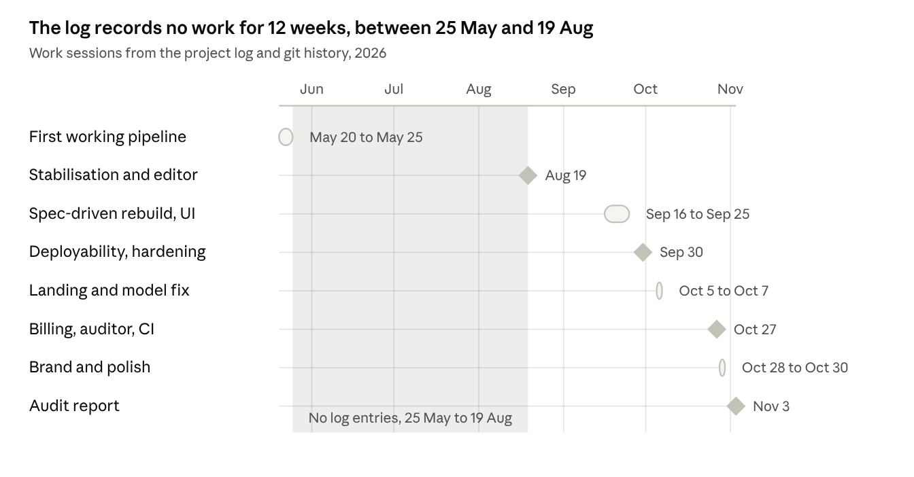

Mint turns a company website or a short questionnaire into an investor-grade deck. It was built between May and October 2026 by a single committer (57 commits), runs on Firebase Hosting and Cloud Run per the project log, and now needs hardening and a few unfinished features before wider launch.

# Project at a glance

| Item | Detail |
|---|---|
| Product | Mint (internal codename iPreneur), an AI pitch-deck generator |
| What it does | Crawls a company website (or takes a founder questionnaire), researches the market, writes every slide, audits the claims, renders a PowerPoint deck |
| Owner | Infopace Management Pvt. Ltd. (proprietary) |
| Repository | github.com/Infopace/Pitch-Deck; application in ipreneur/ |
| Build period | 20 May to 30 Oct 2026 (project log and git history) |
| Contributors | 57 commits from a single committer |
| Users and plans | Founders; Free (₹0) and Pro (₹2,500/month via Razorpay) |
| Deck types | 14 (investor, sales, product, partnership, internal, update, vision, general, elevator, demo day, go-to-market, business plan, master, appendix) |
| Themes | 40 in four families |
| Stack | React 18 and TypeScript frontend; FastAPI and Python 3.11 backend; Google Gemini for AI; PostgreSQL; Playwright crawler; python-pptx |
| Hosting (per log) | Frontend on Firebase Hosting; backend on Cloud Run (asia-northeast1); data on Supabase |
| Size | About 12,800 lines of backend Python, 13,500 lines of frontend TypeScript, 559 passing backend tests |
| Status | Working end to end; needs security hardening, quota enforcement and a few unbuilt features (see Current status) |

# Background and objectives

Founders need a different deck for each room (investors, customers, partners, the board), and most tools produce one generic set of slides with figures nobody has checked. Mint aims to turn a company URL into a defensible deck in minutes, with each deck type written for its own audience.

## Objectives, as stated in the repository

- **Speed:** from a URL to an investor-grade PPTX in minutes (the README cites about 2.5 minutes for the original pipeline).
- **Credibility:** claims grounded in web research and checked against the founder's own figures by a deterministic auditor, with sources captured.
- **Fit:** 14 deck types with their own slide sequences, stage-aware structure (pre-revenue founders are never asked to invent revenue), and Indian conventions (rupees, lakh and crore).
- **Control:** edit text in place, switch among 40 themes, export to PowerPoint.
- **Commercial model:** a Free plan and a Pro subscription billed through Razorpay.

## Target users

Indian and global startup founders at idea, pre-seed, seed and growth stages, plus accelerators and venture studios (the dashboard was redesigned in an accelerator and venture-studio style, log #41 and #43).

## Market positioning

The project's own research (log #56 and `reports/Pitch deck parameters for iPreneur.md`) found no competitor documenting claim-level source checking, stage and sector-aware structure, and India-native formats together. That is the stated open position.

# Product

A founder pastes a URL (or fills a form), picks a deck type, and gets an editable, themed deck with a downloadable PPTX.

## User journey

1. Land on the marketing page, preview themes live, register.
2. On the New Deck form, choose a deck type; the form shows only the fields that type uses and a preview of its slide order. Choose ₹ or $, upload a logo and up to five photos.
3. Watch progress (crawl, research, generate, render, save) on the workspace page.
4. Review the deck, edit any text in place, switch theme, and export to PowerPoint.
5. Upgrade to Pro through Razorpay when the Free limit matters.

## Deck types

| Group | Types (slides) |
|---|---|
| Raise capital | Investor (24, or 22 for idea and pre-seed), Elevator (5), Demo Day (10), Business Plan (25), Extended/Master (25) |
| Win customers | Sales (14), Product/Demo (14), Go-to-Market (22) |
| Align stakeholders | Partnership (15), Internal Decision Memo (10), Investor Update (8) |
| Explain the company | General Overview (20), Vision/Mission (8) |
| Evidence | Appendix (2 fixed bookends plus sections computed from the company profile) |

Internal memos and Investor Updates do no web research, so nothing is invented.

## Quality features

- A deterministic claims auditor checks each deck for invented revenue, inverted market funnels, percentages not totalling 100, unevidenced certifications and leftover placeholders.
- A company profile of 924 parameters records the source, method, confidence and date of each fact.
- 40 light and dark themes in four families; the landing page previews each theme with a different sample deck.
- Branded error, offline and generation-failure screens.

## Plans

| Plan | Price | Marketed limits |
|---|---|---|
| Free | ₹0 | 3 decks a month, basic templates, PPTX export |
| Pro | ₹2,500 a month | 50 decks a month, premium templates, PDF export, priority AI |
| Enterprise | Custom | Unlimited decks, custom branding, API access, team collaboration |

Note: the limits are advertised but not enforced in code, and PDF export and the Enterprise features are not built; the audit report covers this.

# Development timeline

Diamonds are single-day sessions and bars are multi-day runs. The git history in this clone starts on 30 Sep 2026, so the earlier phases are dated from the project log, which may not capture every day of work.

# Milestones and deliveries

The project log (61 entries) records the work from 20 May 2026. The git history in this clone begins on 30 Sep 2026, so earlier dates come from the log alone.

| Date | Milestone | What was delivered |
|---|---|---|
| 20 May | First working pipeline | Fixed a blank-workspace crash; ran generation in-process when Celery was not running; rebuilt the research agent with live web search, a 14-slide content agent, a six-layout PPTX renderer and a rich web preview (log #1 to #10) |
| 21 May | Six-layer AI architecture | Added an analysis agent (investor score, SWOT, scenarios), a branding and website-intelligence layer, and a new progress step; end-to-end test with a fresh Gemini key (log #11 to #19) |
| 25 May | Local auth and generation verified | Confirmed the sign-in and deck flow end to end (log #20) |
| 19 Aug | Stabilisation and new flows | Fixed the "future attached to a different loop" crash and the empty-deck thinking-budget bug; added the no-website intake for idea-stage founders; wired Supabase Storage; quality upgrade to renderer and prompt; inline text editor (log #21 to #29) |
| 8 Sep | Security and infrastructure triage | Removed live credentials from .env.example (history not scrubbed); diagnosed Supabase pause and DNS failures; decided to stay on Supabase Postgres (log #30, #31) |
| 16 Sep | Specification-driven rebuild | Hero redesign; gap analysis against the 924-parameter spec; repaired silent render failures; built the master parameter model; added six deck types, reaching 13 (log #32 to #39) |
| 18 to 25 Sep | Product UI | New sign-up page, executive dashboard redesigns, Apple-style typography, infographic themes, templates gallery, two-pane deck workspace, hourglass loader, retro 404 screen; fabricated dashboard metrics removed (log #40 to #55) |
| 30 Sep | Deployability and hardening | Render and Cloudflare deployment files; rate limiting and optional Sentry; production config guards; orphaned-job reconciliation; truncated-deck detection (git history) |
| 5 to 7 Oct | Landing redesign and model fix | 3D deck showcase hero; Gemini 2.5 Flash retired so the model moved to gemini-3.8-flash; each background thread given its own database engine; research confidence and sources surfaced (git history) |
| 27 Oct | Commercial layer | Razorpay billing; claims auditor; dynamic appendix deck; intake overhaul; rupee support; research report on real-world deck parameters; keyless frontend deploy to Firebase via Workload Identity Federation (log #56 to #61) |
| 28 to 30 Oct | Brand and polish | New Mint logo and landing content; three-tier error pages; offline fallback; form persistence; business-plan deck fields; clickable contact links; PPTX export speed fix (git history) |
| 3 Nov | Audit | Application audit report added to the repository |

# Technical overview

A React single-page app talks to a single FastAPI container; deck generation runs in a background thread inside that container and calls Gemini, the crawler, Postgres and object storage directly.

## Stack

| Layer | Technology |
|---|---|
| Frontend | React 18, TypeScript (strict), Vite, Tailwind, TanStack Query, Zustand, html-to-image and pptxgenjs for browser export |
| Backend | Python 3.11, FastAPI, async SQLAlchemy, Pydantic v2, SlowAPI rate limiting, bcrypt and JWT, Loguru, Sentry (optional) |
| AI | Google Gemini over REST, model gemini-3.8-flash per config, Google Search grounding, two API keys splitting quota |
| Crawler | Playwright (headless Chromium) with BeautifulSoup |
| Documents | python-pptx on the server (editable), pptxgenjs in the browser (image slides) |
| Data | PostgreSQL (Supabase), 6 tables, JSON columns for AI output; S3-compatible storage |
| Billing | Razorpay subscriptions, signed checkout and webhooks |

## How a deck is made

1. **Crawl** (if a website is given): breadth-first, priority-scored, default 18 pages, same domain only.
2. **Research:** Gemini with Google Search grounding finds founders, competitors and market facts; founder-supplied facts override web results. Skipped for decks that must not invent anything.
3. **Generate:** one structured call writes every section in the deck type's exact order, with retries and truncation detection.
4. **Validate and audit:** each section is checked against a typed schema; the claims auditor scores the deck and stores its findings.
5. **Render and store:** python-pptx renders the chosen theme; the file goes to object storage; the project is marked ready.

## Design decisions worth knowing

- **One registry:** the 14 deck types and 65 section specs live in one Python module that drives the prompt, validation, renderer and the frontend form; a test keeps the TypeScript copy in step.
- **Per-section tolerance:** a malformed section is dropped, never the whole deck.
- **Provenance:** every profile value records source, method, confidence and date, with founder answers outranking crawled or researched ones.
- **Money:** one module formats rupee and dollar figures, with lakh and crore, and the auditor catches wrong-currency symbols.

## Deployment (per repository and log)

The frontend deploys to Firebase Hosting from GitHub Actions on pushes to main, using Workload Identity Federation (no stored key). The backend runs on Cloud Run, built by a Cloud Build trigger that is not in the repo. Data is on Supabase. `render.yaml`, `wrangler.jsonc` and `vercel.json` are earlier targets and are not authoritative.

# Current status

The core product works end to end; the gaps are commercial enforcement, security hardening and a few features that are advertised or half-built.

| Area | State | Notes |
|---|---|---|
| Sign-up, sign-in, dashboard | Done | No password reset, email verification or account deletion |
| Website crawl, research, generation | Done | In production per log; runs in an in-process thread |
| 14 deck types and intake forms | Done | Forms driven by the registry |
| 40 themes and in-place editor | Done | Server PPTX renders later theme families in the default look |
| PPTX export | Done | Browser path gives image slides; server path gives editable text |
| Claims auditor | Partial | Runs and is stored; no screen shows the findings |
| Company profile (924 parameters) | Partial | Backend and API only; no frontend screen |
| Razorpay billing | Partial | Built; per log, production keys and plan were not yet set on 27 Oct |
| Plan limits (3 and 50 decks) | Not built | Advertised, never enforced |
| PDF export | Not built | Advertised for Pro |
| Enterprise features | Not built | Custom branding, API access, team collaboration |
| Celery workers | Legacy | Present, not on the live path |

## Metrics

| Measure | Value |
|---|---|
| Commits | 57 (single committer) |
| Backend Python | 12,842 lines |
| Frontend TypeScript | 13,471 lines |
| Backend tests | 559 passing, 1 skipped, 0 failing (9 offline modules) |
| Frontend tests | None |
| Deck types, sections, parameters, themes | 14, 65, 924, 40 |
| API routes | 30 versioned |
| Project log | 1,374 lines, 61 entries |

A separate audit report (`reports/Mint-iPreneur-Application-Audit-Report`) rates security, compliance and operations in detail.

# Challenges and lessons

The project log records the root cause of each incident, which makes these the most reusable lessons.

| Incident | Cause | Fix | Lesson |
|---|---|---|---|
| Every analysis crashed with "future attached to a different loop" (log #21) | A background thread used a database connection owned by the web server's event loop | A separate no-pool engine per background loop | Keep async resources inside the loop that owns them |
| Decks came back with no slides (log #22) | Gemini's thinking tokens consumed the output budget and truncated the JSON | Set the thinking budget explicitly; detect truncation instead of parsing it | Budget model output and check for truncation |
| Generation silently stopped after a Gemini model was retired (Oct) | gemini-2.5-flash closed to new users | Moved to gemini-3.8-flash | Probe model availability at start-up and alert |
| Dashboard spun forever in production | A new column existed in the model but not the database, and create_all never alters tables | Drift check and a migration script | Adopt real migrations |
| Jobs stuck on "generating" after a deploy | Generation runs in a thread that dies with the process | Start-up marks orphaned jobs failed | Move to a queue |
| Real credentials committed to .env.example (log #30) | Original secrets left in a comment block | Block deleted, not rotated or scrubbed from history | Rotate, then scrub, then guard with scanning |
| Pro price almost shown as ₹29 (log #59) | A currency symbol was swapped without changing the amount | Corrected to ₹2,500 | Keep displayed prices tied to the billing plan |
| Whole-deck failure from one bad chart (commit 6b66650) | A market-chart crash aborted generation | Fixed the renderer; sections are validated independently | Isolate failures per section |
| PPTX export took about 21 s for 24 slides (commit 2c3a010) | Font CSS re-fetched for every slide | Compute font CSS once and reuse it | Measure before optimising |
| Frontend could not deploy with a service-account key | Organisation policy blocks key creation | Workload Identity Federation (log #61) | Prefer keyless CI |

# Open work and next steps

The first priority is closing four high-severity gaps before any wider launch; feature work follows.

## Declared in the project log

- Rotate the credentials exposed in an earlier commit and scrub git history (log #30, #52).
- Profile UI and AI pre-fill; the selection engine and evidence layer (Phases 2, 4, 5, paused in log #52).
- Create the Razorpay plan and set production billing variables (log #59).
- Move generation onto the Celery worker so it survives restarts (comment in render.yaml and main.py).
- Server PPTX renders later theme families as the default theme (log #52).

## Recommended priorities

| Priority | Action | Why |
|---|---|---|
| 1 | Authenticate or delete the unauthenticated /pipeline/generate endpoint; add destination checks to the crawler; rotate keys | Cost abuse, server-side request forgery, exposed credentials |
| 2 | Enforce plan limits and meter usage | Advertised Free and Pro limits do nothing today |
| 3 | Add CI: backend tests, frontend build, dependency and secret scans | Nothing gates a merge to main |
| 4 | Show claims-audit findings in the editor | The main trust feature is invisible to users |
| 5 | Ship the profile screen | The 924-parameter engine has no user-facing surface |
| 6 | Queue-based generation, real migrations, hard-delete and account deletion | Reliability and privacy |
| 7 | Deliver or remove PDF export and Enterprise features | Marketed but not built |
| 8 | Refresh README and architecture docs | They describe an earlier Claude and Stripe design |

# Repository guide

| Path | Contents |
|---|---|
| ipreneur/backend/app/ | FastAPI app: api (routes), agents (master, audit, legacy), decks (registry, sections, prompt), profile (924 parameters), ppt (renderer, themes), services (crawler, storage, images), core, db, models |
| ipreneur/backend/test_*.py | 11 test modules, 9 run offline |
| ipreneur/frontend/src/ | 11 pages, shared UI, workspace and deck-template components (TemplatedDeck, DeckWorkspace, exportDeck), API services, auth store |
| ipreneur/PROJECT_LOG.md | 61-entry engineering log: problem, cause, fix, files |
| ipreneur/scripts/db/ | init.sql and migrate.py (no Alembic) |
| ipreneur/docker-compose.yml | Development stack: Postgres, Redis, MinIO, backend, worker, beat, frontend |
| .github/workflows/ | Frontend deploy to Firebase Hosting |
| render.yaml, wrangler.jsonc, vercel.json | Earlier deployment targets, not authoritative |
| reports/ | Pitch-deck parameter research and the audit report (Markdown, Word, PDF) |
| research_notes/ | Six notes on competitors, investor behaviour, India fundraising norms |
| Root documents | Bootstrap blueprint, Pitch Deck Parameters.docx (the 924-parameter spec), design archives, standalone demo HTML |

Do not rely on README.md, ipreneur/README.md or docs/architecture/ARCHITECTURE.md; they describe an earlier design. Prefer the code and PROJECT_LOG.md.
